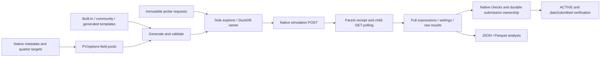

# Architecture

The engine turns scoped research ideas into native simulations and verifies submission outcomes. Live service and authorization state are deployment-local; consult the private owner handoff before lifecycle actions.

## Execution flow

A separate email archival routine saves all research categories. It does not register templates, queue experiments or launch the explorer.

## Components

| Component | Responsibility and important entry points |
|---|---|
| Entry / supervision | `simulate_alphas.py`, `simulate_alphas_config.py`, `tools/run_explorer_supervised.sh` |
| Platform primitives | `core/auth.py`, HTTP timeout/reauth/retry modules, `core/budget/`, regions, constraints, logging |
| Database | `core/db/`: DuckDB connection compatibility layer, schema/init/migrations and process-local coordination |
| Metadata download | `download/brain_data.py`, field storage, scoped refresh and native pyramid downloads |
| Generator interface | `generator/interface.py`; implementations in `random_generator*` |
| Field roles | MATRIX/VECTOR/GROUP pools; `field_queries*`, `field_validation_pools.py`, role/type validation |
| Template sources | `registry.py`, website/cnhkmcp families, mined corpora, generated idea families |
| Selection | `diversity_picker/`, priors, correlation feedback, template and cell weights |
| Simulation lifecycle | `runner/explore_loop/`: startup, reattachment, fill, poll, budget wait and maintenance |
| Frozen experiments | `runner/probe_requests.py`, `probe_validation.py`, `probe_queue_store.py` |
| Results | `storage/store_sim*`, `store_alpha*`, attribution/signature tracking |
| Checks / submissions | `checker/`, `runner/submit/`, `runner/submit_progress.py`, `runner/verify_submit.py` |
| Submission ownership | `storage/submission_requests.py`, `store_submission_receipt.py` |
| Operations / analysis | `tools/`; campaign-specific observers under `brain_logs/` |

## Generator contracts

The registry supports two calling conventions: templates receiving two selected fields, and pool templates receiving a scoped pool plus RNG. `POOL_TEMPLATES` determines dispatch; changing a parameter name must not change the convention.

A corpus skeleton is not automatically executable. Bind placeholders to matching roles, reject literal out-of-scope fields, require current native operators and validate syntax/types. Do not substitute arbitrary price fields when an options or volume operand is missing.

Field availability belongs to the full region/universe/delay cell. Structural GROUP values may define partitions; category codes and city/country identifiers must not be ranked as measurements simply because the API labels them MATRIX.

## Runtime recovery and boundaries

The explorer owns the live DB and persists accepted-parent receipts, expression/settings provenance and claim states. The supervisor can restart it, and startup restores caches and reattaches recent parents. It also starts background submission checking: starting the service has external effects.

Probe requests are content-addressed files. The sole writer validates and inserts them idempotently. A claimed request with no stored native receipt becomes uncertain; it must not be reposted automatically.

Quarterly pyramid targets are refreshed through the existing writer and filtered to the current quarter. Lifetime alpha counts cannot substitute for current-quarter eligibility.

## Evidence, not inferred success

- Native parent acceptance is separate from completed measurements.
- Completed/strong backtests are separate from final submission eligibility.
- HTTP201 submission acknowledgement is separate from verified ACTIVE/dateSubmitted.
- Verified alpha acceptance is separate from actual published combined OS metrics and Expert promotion.

See [Data](docs/DATA.md) for persistence contracts, [Research](docs/RESEARCH.md) for validation, and [Operations](docs/OPERATIONS.md) for safe recovery.

## Design limits

Scope screening is a name-based helper, not complete field-semantic or atom dependency analysis. The submission collector can abstain on unreadable payloads. Native APIs remain the final authority; retries, local parser success and supervisor restarts do not establish remote termination. Credentials load only from environment/private files; the offline suite blocks production DB access and network sockets. No broker/order execution or automatic deployment is implemented by this research pipeline.
